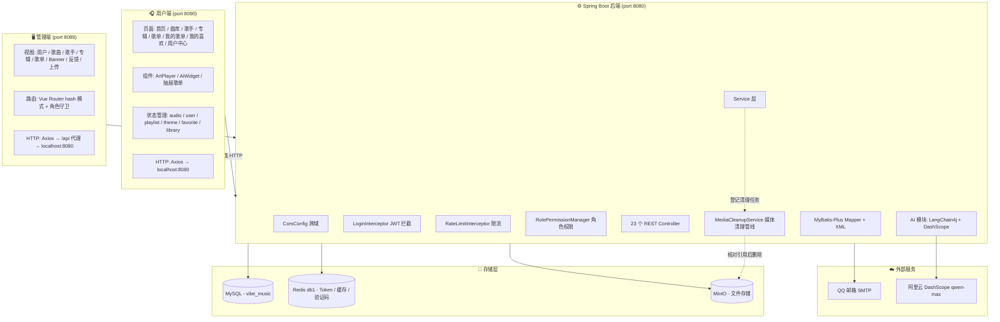
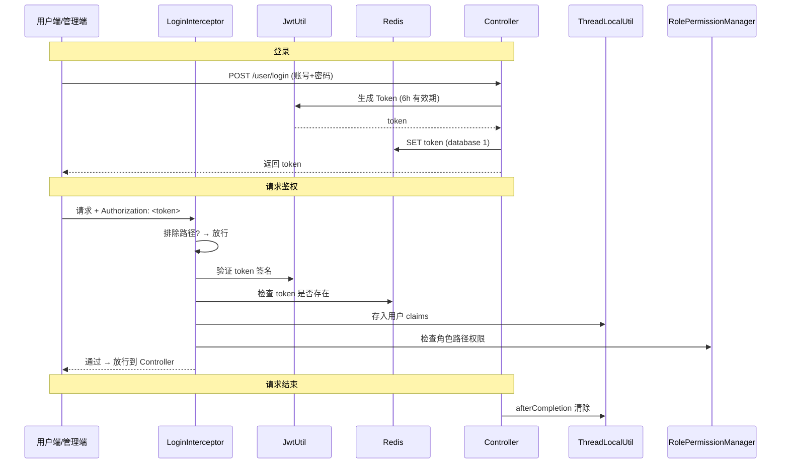
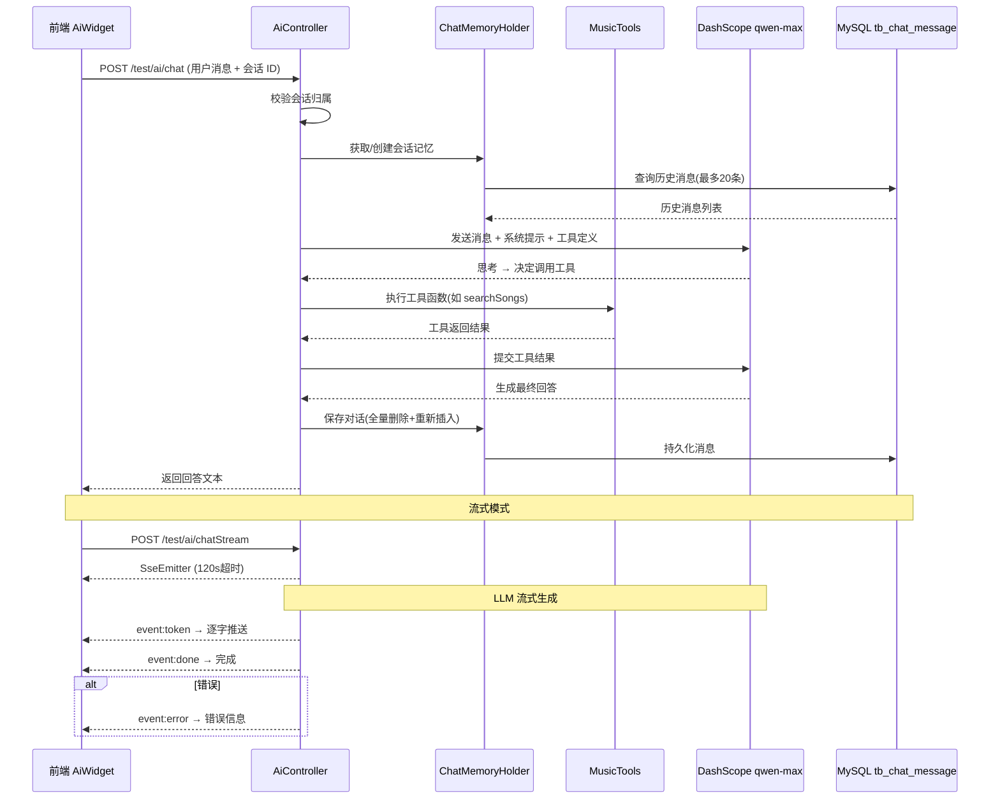
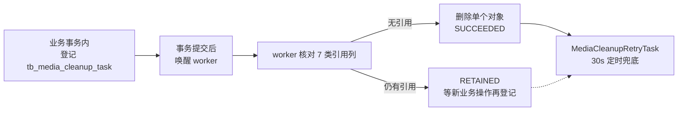
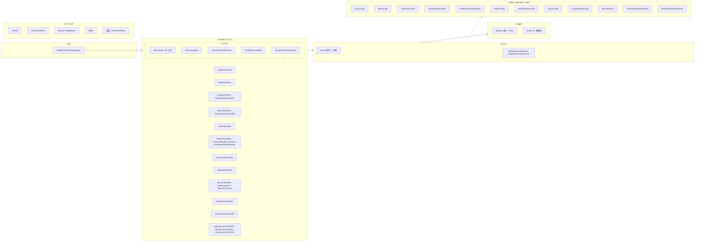
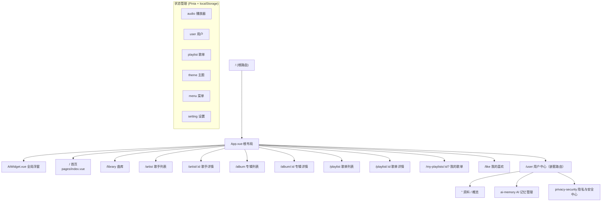

# Vibe Music 🎵

全栈音乐流媒体平台 — 智能推荐、AI 对话、多端管理

## 项目结构

本项目包含三个独立子项目（无父级 POM / 工作空间），由 GitHub Actions 统一构建校验：

| 子项目 | 类型 | 端口 | 技术栈 |
|---|---|---|---|
| `vibe-music-server/` | Spring Boot 3 后端 | 8080 | Java 17, Maven, MyBatis-Plus, MySQL, Redis, MinIO, LangChain4j |
| `vibe-music-admin/` | 管理端 SPA | 8089 | Vue 3, Vite 6, Pinia, Element Plus, vue-pure-admin |
| `vibe-music-client/` | 用户端 SPA | 8090 | Vue 3, Vite 6, Pinia, Element Plus, ArtPlayer |
| `.github/workflows/ci.yml` | CI | — | 后端构建 + 全量测试 + Agent 离线评测；双前端生产构建 |

> 后端默认监听 `8080`，两个前端通过 `vite.config` 代理或直连访问；开发机需自行准备 MySQL / Redis / MinIO。

## 系统架构图



## 功能特性

### 🎶 音乐管理
- 歌曲、歌单、歌手、专辑、Banner CRUD 管理
- 推荐算法（热门推荐、风格推荐、随机发现）
- 文件上传（MinIO 分布式存储，专辑 / 单曲两段式创建）
- 评论、收藏、歌词系统
- **多歌手支持**：`tb_song_artist` 关系表 + `artists` 结构化字段，一首歌可关联多位歌手（含合作演唱）
- 管理端列表列头排序、拼音排序、歌手状态筛选；停用歌手的内容全站隐藏

### 🤖 AI 音乐助手
- 基于 LangChain4j + 阿里云 DashScope（qwen-max）的智能对话
- **8 个工具函数**：歌曲搜索、按歌手检索、按风格检索、歌单候选检索（带近期去重）、随机推荐、歌手搜索、歌手详情、歌单搜索
- 流式 SSE 输出，前端逐字渲染
- **多会话支持**：新建会话、历史列表、会话切换，会话归属校验
- 对话历史持久化（MySQL + 20 条消息窗口）
- **AI 记忆与偏好**：个性化记忆、摘要记忆、偏好纠正与确定性排除
- 支持登录用户和游客两种模式

### 🔐 认证与权限
- JWT 令牌认证（有效期 6 小时，Redis db1 白名单）
- 双角色权限控制（ROLE_ADMIN / ROLE_USER），路径级角色权限表
- 请求限流拦截器（RateLimitInterceptor）
- 密码强度规则单一来源（后端 `constant/PasswordRules` 与前端 `utils/password.ts` 逐字一致）
- 隐私与安全中心：修改密码、账号注销（可恢复）、字段脱敏
- ⚠️ 公开管理员注册端点已下线（`/admin/register` 移除且不在白名单），建管理员走运维 SQL

### 🖥️ 管理端
- 用户管理、歌曲管理、歌手管理、专辑管理、歌单管理
- 反馈管理、Banner 管理、上传工作台
- 数据看板

### 🎧 用户端
- 音乐播放器（ArtPlayer）
- 曲库浏览、歌单收藏、专辑详情
- 歌手详情、我的歌单
- 用户中心（嵌套路由）：AI 记忆管理、隐私与安全中心
- AI 聊天浮窗

### 🧹 存储治理
- 对象存储引用审计（只读）与媒体清理管线
- 删除前引用核对，杜绝共享封面 / 共享音频被误删
- 失败可重试、可持久化恢复的任务表

## 认证流程



请求头格式为 `Authorization: <token>`（兼容 `Bearer ` 前缀，会被自动剥离）。部分列表接口在 `WebConfig` 中不整体排除，而是「匿名可访问 + 携带 token 时校验身份」，用于个性化排序与收藏标记。

## AI 对话流程



## 媒体清理与对象存储生命周期

歌曲 / 专辑 / 歌单封面与音频在 MinIO 中大量跨表共享（实测 262 个对象被 ≥2 行引用，单对象最多 15 行），**直接删除对象会破坏其他仍在引用的记录**。因此删除走三段式管线：



核心约束（改动此模块前必读）：

- **可靠性只来自数据库**，不依赖 `afterCommit` 回调或内存状态；定时任务兜底扫 `PENDING` / `RETRY_WAIT`。
- **引用核对谓词是「URL 以对象键结尾」**：`RIGHT(列, CHAR_LENGTH(#{objectKey})) = #{objectKey}`。同一列并存 `localhost:9005` 与 `127.0.0.1:9005` 两种主机名，按完整 URL 相等判定会把仍被引用的对象判为「无引用」而误删。
- 7 类引用列：`tb_song.cover_url/audio_url`、`tb_album.cover_url`、`tb_playlist.cover_url`、`tb_artist.avatar`、`tb_user.user_avatar`、`tb_banner.banner_url`；**不过滤可见性**（停用歌手 / 草稿专辑 / 私有歌单都算引用）。
- 任务表唯一键 `(source_type, source_ref, key_digest)`，`object_key` 列使用 `utf8mb4_bin` 排序规则（S3 key 大小写敏感）。
- 状态机 `PENDING → RUNNING(租约+代次) → SUCCEEDED / RETRY_WAIT / FAILED / RETAINED`，所有回写带 `generation + lease_owner` 条件。
- **只允许删除单个完整对象 key**，禁止前缀删除、通配符删除、批量删除 API。
- 已知残余竞态：worker「核对无引用」与「执行删除」之间仍有窄窗口，彻底消除需引入 `tb_media_object` 登记表 + 锁协议（DDL 已注释在迁移文件末尾）。

## 后端包结构



## 用户端页面路由



## 数据库迁移

数据库结构通过**幂等 SQL 脚本**按阶段演进，位于 `vibe-music-server/sql/`：

| 脚本 | 内容 |
|---|---|
| `vibe_music.sql` | 基础库结构与初始数据 |
| `phase2_*.sql` | 聊天记录、收藏、个人歌单 |
| `phase3_playlist_state_and_cover.sql` | 歌单发布状态与封面 |
| `phase4_agent_actions.sql` | Agent 动作记录 |
| `phase5_personalization.sql` | 个性化数据 |
| `phase6_song_multiple_artists.sql` | 多歌手关系表（含 `_rollback`） |
| `phase7_conversations.sql` | AI 多会话 |
| `phase8_ai_memory_preferences.sql` | AI 记忆与偏好 |
| `phase10_account_cleanup.sql` | 账号注销任务 |
| `phaseC_media_cleanup.sql` | 媒体清理任务表（`tb_media_object` DDL 以注释附于末尾，待后续阶段启用） |

脚本均可在已有库上重复执行，新环境按上表顺序导入。

## 快速开始

### 环境要求

- JDK 17+
- Maven 3.8+
- Node.js 18+（CI 使用 Node 20）
- pnpm 7+（CI 使用 9.15.2）
- MySQL 8.0+
- Redis 6+
- MinIO

### 启动后端

```bash
# 1. 导入数据库
cd vibe-music-server/sql
mysql -u root -p --default-character-set=utf8mb4 < vibe_music.sql
# 再按需执行后续 phase*.sql

# 2. 配置敏感项：复制 .env.example 为 .env（已被 gitignore）
#    MYSQL_USERNAME / MYSQL_PASSWORD / MAIL_USERNAME / MAIL_PASSWORD
#    MINIO_ACCESS_KEY / MINIO_SECRET_KEY / DASHSCOPE_API_KEY
#    其余连接信息在 application.yml

# 3. 启动服务（Redis 需无密码，与 application.yml 一致；Redis 使用 db1）
cd vibe-music-server
mvn spring-boot:run
```

健康检查：匿名访问任意受保护接口应返回 `401`，说明拦截器已生效。

### 启动管理端

```bash
cd vibe-music-admin
pnpm install
pnpm dev
```

### 启动用户端

```bash
cd vibe-music-client
pnpm install
pnpm dev
```

## 测试与 CI

### 本地测试

```bash
cd vibe-music-server

# 全量测试（除需要真实 MySQL/Redis 的两个用例，其余使用 H2 内存库）
mvn test -Dtest='!RedisConnectionTest,!VibeMusicServerApplicationTests'

# 仅跑某个模块
mvn test -Dtest=MediaCleanupTaskTest
```

- 单测默认使用 **H2（MySQL 兼容模式）+ 脚本化模型替身**，不依赖 MySQL / Redis / MinIO / DashScope。
- `RedisConnectionTest`、`VibeMusicServerApplicationTests` 需要真实环境与 `.env`，CI 中排除。
- ⚠️ 涉及 `MusicAssistant.SYSTEM_PROMPT` 等编译期常量时，改动后需 `touch` 测试文件再跑，避免增量编译漏编。

### 端到端验收

仓库根 `scripts/` 下存放 E2E 脚本（gitignore，不入库），典型如：

- `phaseA-e2e.cjs` — 权限加固验收
- `phaseC-e2e.sh` + `phaseC-e2e-call.cjs` — 媒体清理管线验收（bash 编排 + node 只做 HTTP）

### CI

`.github/workflows/ci.yml` 在 `main` / `master` / `develop` 分支的 push、PR 及手动触发时执行：

| Job | 内容 |
|---|---|
| `server` | `mvn -B -ntp verify`，含 46 条 Agent 离线评测；上传评测报告与 surefire 报告 |
| `client` | 用户端 `pnpm install --frozen-lockfile` + `pnpm build` |
| `admin` | 管理端 `pnpm install --frozen-lockfile` + `pnpm build` |
| `online-eval` | 可选，需仓库 Secret `DASHSCOPE_API_KEY`，仅在手动触发时运行真实模型评测 |

> 当前开发分支为 `test1`，不在 CI 触发分支列表中。

## 文档索引

| 文档 | 说明 |
|---|---|
| `CLAUDE.md` | 架构说明与工程约定总览 |
| `SECURITY.md` | 安全策略与密钥管理 |
| `vibe-music-server/docs/` | 各阶段设计与验收报告（安全、业务基础、多歌手、会话与账号、媒体清理等） |
| `vibe-music-server/docs/plans/` | 阶段性实施方案（AI 个性化、权限加固、媒体清理等） |
| `agent_ai_plan.md` / `future_plan.md` | Agent 规划与后续路线 |

## 技术亮点

- **AI 深度集成**：LangChain4j + DashScope，工具调用驱动的音乐领域问答，含偏好记忆与确定性排除
- **流式响应**：SSE + ReadableStream 实现 AI 回复逐字渲染
- **多歌手建模**：关系表 + 结构化字段双写，展示串与事实关系分离，杜绝 `LIKE` 反查
- **存储安全**：基于数据库的媒体清理管线，删除前跨 7 类引用列核对，杜绝共享对象误删
- **缓存策略**：Spring Cache + Redis 多级缓存，键名携带结构版本号防止脏缓存
- **可重复测试**：H2 + 模型替身实现离线全量测试，评测结果进 CI

## 技术栈

| 层 | 技术 |
|---|---|
| 后端框架 | Spring Boot 3.3.7, MyBatis-Plus 3.5.9 |
| 数据库 | MySQL 8.0, Redis（db1） |
| 对象存储 | MinIO |
| AI | LangChain4j 0.36.2, DashScope (qwen-max) |
| 认证 | Auth0 java-jwt 4.4.0 |
| 管理端 | Vue 3, Vite 6, Pinia, Element Plus, vue-pure-admin |
| 用户端 | Vue 3, Vite 6, Pinia, Element Plus, ArtPlayer |
| 构建 / CI | Maven, pnpm, GitHub Actions |
